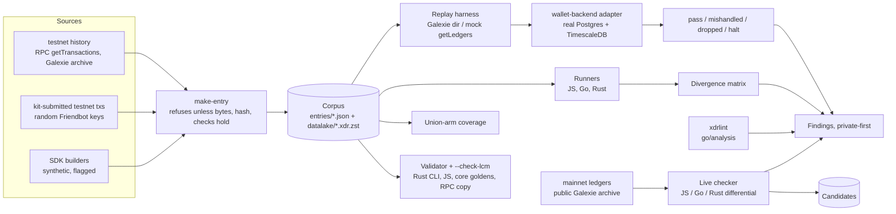

# Architecture

Status: Nov 2026. Sections marked **[Built now]** exist in this repo and run in CI; **[Roadmap]** is the plan.

## Goals and limits

- One language-neutral corpus: XDR bytes plus a JSON manifest, and the real `LedgerCloseMeta` behind each entry. Any SDK or indexer can read it without our code.
- Entries are what stellar-core actually emitted. Anything built by hand is `synthetic` with a reason.
- Provenance is honest: an entry says whether the kit submitted the transaction (`submitted_by_kit`) or found it in history (`mined_from_testnet_history`).
- Every check runs offline, in CI. No keys, no funds.
- Verdicts come from stored data, never from exit codes.

## Overview



## 1. Corpus [Built now]

`schema/corpus-entry.schema.json` v0.2.0. One JSON file per entry in `corpus/entries/`:

- `caps`, `protocol.introduced_in`, `protocol.captured_on`, `protocol.xdr_ref` (stellar-xdr version used to decode).
- `network.passphrase` and `expected_tx_hash`.
- `xdr.type`, `xdr.base64`, `xdr.sha256`.
- `provenance.origin`: `submitted_by_kit | mined_from_testnet_history | mined_from_mainnet_history | local-core | synthetic`, with `origin_note`, `tx_created_at`, `retrieved_at`, `raw_committed_at`.
- `ledger`: the `LedgerCloseMeta` the entry came from: file in Galexie layout, `sha256_zst`, `sha256_lcm`, `tx_index`, protocol, source URL, and the hash of a second copy if one exists (`alt_source`).
- `expected.json` (SEP-51 XDR-JSON from rs-stellar-xdr), `expected.checks` (JSON Pointers into it), `expected.ledger_checks` (JSON Pointers into the decoded LCM, with `$TX` for the entry's transaction).

The data lake (`corpus/datalake/testnet`) uses Galexie's layout (`.config.json`, zstd `LedgerCloseMetaBatch`, one ledger per object, 64000 per partition), so indexers that read a Galexie datastore read it unchanged. `corpus/datalake/SOURCES.json` records where each object came from.

Tools: `tools/capture-testnet.mjs` (submits the P30 shapes), `tools/mine-testnet.mjs` (finds nested auth trees in history), `tools/fetch-lcm.mjs` (archive first, RPC fallback), `tools/make-entry.mjs` (writes an entry only if the rust round-trip, tx hash, checks and ledger checks all hold).

## 2. Validation and golden checks [Built now]

- `tools/check-corpus.mjs`: schema, byte-exact round-trip in rs-stellar-xdr (stellar CLI) and js-stellar-sdk, JS JSON == Rust JSON, tx hash, checks; for LCM entries the same on the whole LCM plus file hashes and the tx at `tx_index`.
- `--check-lcm` (`tools/check-lcm.mjs`): stellar-core #5435 added a `--check-lcm` mode that checks core's own captured LCM goldens (`src/testdata/ledger-close-meta-v2-protocol-<P>.json`). The kit vendors those goldens for the protocols in the corpus (P28, P29, P30, at core `f2b91947`) and compares shape: LCM version, ledger_version, StellarValueExt arm, CAP-88 `floor(close_time_ms/1000) == close_time`, TransactionMeta version, LedgerCloseMetaV2 fields. It also compares each archive LCM with a copy from RPC `getLedgers`, byte for byte and then part by part. Verdicts: agrees / diverges / no_golden.

## 3. Coverage [Built now]

`tools/coverage-report.mjs` takes the universe from the reference implementation: every `oneOf` (union) and `enum` in `stellar xdr types schema --type LedgerCloseMeta`, plus ScAddress, MuxedAccount and SignerKey classified by strkey prefix. It walks each entry's own value, its transaction's `TransactionResultMetaV1` and the ledger header (entry scope), and every corpus LCM in full (ledger scope). CI fails if `reports/coverage.md` is stale.

## 3a. Real-network frequency [Built now]

`tools/frequency/run.mjs` measures how often each of the 376 union arms, and each shape behind the corpus entries and the reproduced bugs, occurs in real `LedgerCloseMeta`. It reads SDF's Galexie export on AWS Open Data (pubnet and testnet), decodes each ledger with the reference implementation, walks it with the same schema walker as the coverage report (`tools/xdr-walk.mjs`), attributes every envelope to its transaction hash (`tools/frequency/txhash`, Go), and runs the shape detectors in `tools/frequency/shapes.mjs`. The sample is fixed in `tools/frequency/plan.json`: 50,000 contiguous recent mainnet ledgers, 500-ledger windows every 100,000 ledgers from the Protocol 23 upgrade (Sep 2025) to Nov 2026 (33,500 ledgers), and 10,000 recent testnet ledgers. Results are per chunk in `tools/frequency/.work/` (resumable); `reports/frequency.md` and `reports/raw/frequency.json` are committed, and CI checks that the markdown matches the committed data. The study is how corpus priorities are set: rare-but-real arms first, arms never seen on mainnet later.

## 3b. Live differential checker [Built now]

`tools/livecheck/` watches what the network sends instead of replaying what was already reported. Every ledger is decoded by three independent readers: js-stellar-sdk 17.4.0, go-stellar-sdk 0.9.0 and rs-stellar-xdr 30.0.0 (Go and Rust as long-running processes). Each reader projects its decode to the same canonical token stream: a type-driven walk in XDR order with exact decimal integers (128/256-bit parts folded), opaque bytes as hex, and every account, muxed account, contract, muxed contract (W), balance, pool and signer key (incl. P) encoded as a strkey by that reader's own SDK. Tokens are grouped per ledger header, per envelope and per result meta, hashed, and compared; differing segments are dumped and the first differing token, its path and the odd reader are reported. The checker flags decode failures, disagreements, byte round-trip mismatches (Rust also SEP-51 JSON back to XDR), 64-bit values that the JS SDK's high-level objects surface as unsafe JS numbers, union arms that are first-seen or long-tail against the frequency baseline, and the frequency study's bug shapes. Each flagged transaction becomes a candidate with inferred CAP tags, tx hash, ledger and the raw envelope and result-meta XDR (`corpus/candidates/livecheck/`), outside the reviewed corpus.

`backfill.mjs` runs it over archived ranges (resumable per 250-ledger chunk; results in `reports/livecheck/`). `live.mjs` follows mainnet: it polls SDF's public Galexie archive for the next ledger object, checks it, appends each flag to a JSONL log, writes candidates and a rolling `latest.md`, and checkpoints its cursor after every ledger; worker processes check ledgers ahead of the cursor in parallel and results are committed in ledger order, and `state.json` / `latest.md` record the measured lag behind the network tip; `run-live.sh` restarts it if it exits. `tools/livecheck/test.mjs` (in CI) runs the three readers on the committed P28/P30 testnet ledgers and one mainnet ledger, requires full agreement and byte round-trips, and checks that a divergence injected into one reader is caught, located and attributed. Limits: three readers can share a mistake; first-seen depends on the baseline sample; CAP tags are inferred. Details: [tools/livecheck/README.md](tools/livecheck/README.md).

## 4. Replay harness [Built now: wallet-backend] [Roadmap: more adapters]

`harness/adapter.go` defines:

```go
type Adapter interface {
    Name() string
    Prepare(ctx, Build) error                              // pin a commit (+ documented shim)
    IngestLedgers(ctx, Source, []uint32) ([]IngestOutcome, error)
    Verdict(ctx, Case, IngestOutcome) (Result, error)      // must read the indexer's stored state
    Close() error
}
```

- Sources: `galexie:<dir>` (go-stellar-sdk `BufferedStorageBackend` over a `Filesystem` datastore) and `rpc:<url>` (`RPCLedgerBackend` against `harness/mockrpc`, which serves `getLedgers` from the same directory).
- wallet-backend adapter: a git worktree per commit, `zz_xck_ingest_test.go` copied into `internal/services`, which runs wallet-backend's own migrations, indexer, `processLedger` and `insertIntoDB` in a transaction against a fresh database. Signatures that changed between commits are called through reflection so one file compiles everywhere.
- Verdicts by SQL: `halt` = no transactions stored for the ledger; `dropped` = ledger stored, expected row missing; `mishandled` = row stored with a wrong value (decoded from wallet-backend's `AddressBytea`); `pass`.
- Shim: commits pinned to go-stellar-sdk v0.7.3 cannot decode P30 ledgers; for those rows the harness runs `go get github.com/stellar/go-stellar-sdk@v0.8.0`. No wallet-backend source file changes. Every row records it.
- stellar-etl: assessed, spec in `harness/ADAPTERS.md`; run in the Milestone 3.1 upstream audit sweep.

## 5. Runners and divergence matrix [Built now]

- JS (js-stellar-sdk 17.4.0) and Rust CLI (stellar 30.0.1) in `tools/check-corpus.mjs`.
- Go (`runners/go`, go-stellar-sdk v0.9.0): decode, re-encode, hashes, strkey checks by walking the decoded value; JSON-pointer checks are n/a (no SEP-51 encoder in Go).
- Rust crate (`runners/rust`, stellar-xdr =30.0.0): decode, re-encode, JSON, checks.
- `tools/divergence-matrix.mjs` merges the four runners' rows with the pinned-version repros and the replay results.
- A failure in one SDK triggers a sibling check in the others before anything is filed.

## 6. Linter [Built now: XDRL002] [Roadmap: XDRL001, XDRL003]

`linter/` is a `go/analysis` analyzer (`xdrlint`, standalone or `go vet -vettool`).

| Rule | Mistake | Status |
|---|---|---|
| XDRL001 | Trusting unvalidated passthrough fields (memo, auth trees, muxed IDs) | Milestone 2 |
| XDRL002 | Recursion over ScVal / SorobanAuthorizedInvocation / ClaimPredicate with no depth or size cap | Built; analysistest seeded + clean fixtures |
| XDRL003 | Participants from the envelope instead of the meta | Milestone 2 |

## 7. Hardening guide [Roadmap]

MDX for developers.stellar.org with a fixed outline: validated vs unvalidated fields, recommended caps, participants from meta, muxed and signed-payload handling including SEP-23 strkeys, checklist. The field table is generated from the corpus manifest. Publication waits for review by a core or platform engineer.

## 8. CI [Built now]

`.github/workflows/ci.yml`: corpus (schema, round-trips, `--check-lcm`, coverage freshness, Go and Rust runners, committed runner outputs, divergence-matrix freshness), live checker (three readers on fixture ledgers, injected divergences), JS repros, x402 repro, wallet-backend (column-type repros + replay against a `timescale/timescaledb:2.28.2-pg17` service, replay report must match the committed one), linter (analysistest + pinned wallet-backend scan). `scripts/ci-local.sh` runs the same steps on one machine.

## 9. Findings and disclosure

- Every finding records the corpus entry, component, CAP, severity, repro command and upstream link.
- Before filing: check duplicates, confirm on the latest release, run the sibling check.
- **Private-first:** anything that crashes an indexer or halts ingestion on a current release goes to the maintainers privately through their security policy, and is published only after a fix or an agreed date.

## 10. Protocol upgrades [Roadmap]

1. Entries pin a stellar-xdr version.
2. A scheduled job rebuilds against the next stellar-xdr tag and SDK release candidates and lists entries whose decode or JSON changed.
3. New CAP: add coverage rows, capture its shapes on testnet, tag.
4. Re-vendor core's `--check-lcm` goldens for the new protocol and rerun.
5. Release a corpus version per protocol.

## Milestones

Three milestones.

| Milestone | Deliverables | Acceptance |
|---|---|---|
| 1 | 1.1 Schema v1, coverage manifest and initial core-emitted corpus | Tagged release; every entry passes schema validation in CI; `coverage.json` has a row for every listed CAP with entry IDs or an explicit gap; every listed high-risk shape has at least one non-synthetic entry; CI green. |
|  | 1.2 Rust core-emitted generator and `--check-lcm` golden verification | One command regenerates the corpus on a clean runner for both passphrases; all entries round-trip byte-exact through rs-stellar-xdr; golden check runs in CI and reports agree / no-golden per entry; the generator refuses a deliberately corrupted fixture. |
| 2 | 2.1 Streaming Galexie replay harness and wallet-backend reference adapter | CI reproduces wallet-backend #729, #731 and #716 on pre-fix commits and passes on the fixed commits; the harness runs the full corpus under a fixed memory limit and fails if exceeded; adapter interface documented. |
|  | 2.2 Cross-SDK conformance runner and divergence matrix | CI reproduces js-stellar-sdk #1766, #1785 and #1789 on pre-fix tags and passes on fixed tags; matrix published on every run; sibling-issue template and workflow in the repo. |
|  | 2.3 Go static-analysis linter | `analysistest` fixtures pass with every seeded violation flagged by the right rule ID; the linter runs in CI against current wallet-backend with zero unresolved findings: every finding is either fixed upstream or documented and triaged in the findings report (security-relevant findings disclosed privately first). |
|  | 2.4 STRIDE threat model and monitoring plan | `SECURITY.md` and `docs/threat-model.md` merged; each mitigation linked to a CI check or test; scheduled upgrade-watch job running. |
| 3 | 3.1 Full Protocol 20 to 30 CAP expansion and upstream audit sweep | `coverage.json` shows every P20 to P30 shape covered or justified as a gap; findings report with one row per finding linking a filed issue (security findings disclosed privately first); every failure maps to an issue. |
|  | 3.2 Indexer-hardening guide | PR opened to developers.stellar.org; CI check proves the field table equals the manifest; review requested from a stellar-core or platform engineer. |
|  | 3.3 Reusable GitHub Action, upstream CI PRs and external maintainer testing | Action published and used in at least one external repo or open upstream PR; external feedback recorded with resulting issues closed or scheduled. |
|  | 3.4 v1.0 release, protocol-upgrade watcher and maintenance runbook | v1.0 tag and release notes; CI green; watcher running on schedule; runbook exercised once against the latest stellar-xdr tag or release candidate. |
