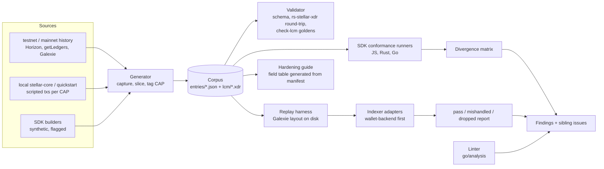

# Architecture (proposal draft)

Status: draft for the SCF #46 RFP 02 proposal, Nov 2026. Parts marked "built" exist in this repo and run. The rest is the plan.

## Goals and limits

- One language-neutral corpus: XDR bytes plus a JSON manifest. Any SDK or indexer can read it without our code.
- Entries are what stellar-core actually emits. Captured from testnet, mainnet or a local core. Anything built by hand is marked `synthetic` with a reason and a plan to replace it.
- Every check runs offline, in CI, on every PR. No keys, no funds, bounded memory.
- Findings go upstream as small, reproducible issues. The run is not the deliverable; the filed and triaged findings are.

## Overview

## 1. Corpus format (built, draft v0)

`schema/corpus-entry.schema.json`. One JSON file per entry:

- `id`: stable, never reused.
- `caps`: CAP numbers that introduced or changed the shape. `protocol.introduced_in` and `protocol.captured_on`.
- `network.passphrase` and `expected_tx_hash`, so a reader can prove the bytes are the signed transaction.
- `xdr.type`, `xdr.base64`, `xdr.sha256`. Large values (LedgerCloseMeta) go in a side file referenced by `xdr.file`.
- `provenance`: `testnet | mainnet | local-core | synthetic`, plus ledger, tx hash, source URL. `synthetic` requires `synthetic_reason`.
- `expected.json`: SEP-51 XDR-JSON produced by rs-stellar-xdr. This is the reference decode.
- `expected.checks`: the few facts a reader must get right, as JSON Pointers into `expected.json` (for example "this map has 2 entries", "this signer is the full P... key").
- `tags` (muxed, signed-payload, issuer-sort, max-length, nested-auth, key-collision, non-utf8, ...) and `linked_issues`.

Why SEP-51 JSON as the reference: rs-stellar-xdr and js-stellar-sdk v17 both produce it, and in this repo they already agree byte for byte on all 3 sample entries. Go has no SEP-51 encoder, so the Go runner compares the fields the checks name.

## 2. Generator

Three sources, in order of preference:

1. **History capture (built for envelopes).** `tools/make-entry.mjs` takes a captured transaction, decodes it with rs-stellar-xdr, refuses to write the entry unless it re-encodes to the same bytes, and recomputes the tx hash under the network passphrase. The 2 captured samples come from testnet ledgers 4437357 (CAP-40 P signer, protocol 28) and 5699707 (muxed ID 2^64-1 to muxed ID 0, protocol 30).
2. **Local core.** For shapes that are rare on public networks (SAC `trust()` under CAP-73, muxed contract `W...` addresses under CAP-84, deep auth trees, max-length vectors), a scripted run against quickstart (local stellar-core + RPC) submits the transaction, pulls the LedgerCloseMeta through `getLedgers`, and slices out the transaction, its meta and its events. Runs for both passphrases by replaying the same script with a standalone network configured with each passphrase, so the hashes differ and both are recorded.
3. **Synthetic.** SDK builders, only when 1 and 2 are not possible yet. Always flagged.

Rust is the main generator language (rs-stellar-xdr is the reference for the round-trip check the RFP names). The JS prototype here moves to Rust in M1.

Agreement with stellar-core goldens: stellar-core #5435 added `--check-lcm`, with goldens stamped by protocol version. The validator decodes those golden files with the same code path and checks every corpus LCM entry for the same tx shape agrees field by field.

## 3. CAP tagging and coverage manifest

`coverage.json` (M1) lists every CAP from protocol 13 to 30 that changed XDR or meta, with the shapes it introduced and the entry IDs that cover each one. Coverage gaps are explicit rows, not silence. First pass priority: the shapes the RFP lists (issuer sort, muxed source and destination, muxed and offer IDs, max-length vectors, nested auth, colliding map keys), then the CAP-67 unified events, CAP-73, CAP-71 auth delegation, CAP-84 muxed contracts and CAP-88 ms close time.

## 4. Replay harness

- Input: corpus LCM entries.
- Delivery: **Galexie data lake layout first**, written to a local directory. wallet-backend already has a datastore ledger backend, and go-stellar-sdk's datastore supports a `Filesystem` type, so the indexer reads our ledgers with no network and no code change on its side. Mock RPC `getLedgers` second, for indexers that only speak RPC.
- Adapter interface: `start(dir) -> run to ledger N -> read results -> stop`. The adapter maps each entry to what the indexer should have written (rows, state changes, participants) and reports `pass`, `mishandled` (wrong value) or `dropped` (nothing written).
- Reference adapter: wallet-backend with Postgres in a container. Acceptance: #729, #731 and #716 fail on the pre-fix commits and pass on the fixes. Today this repo reproduces #729 and #716 at the storage-type level (see repros/). #731 needs the full replay and is the first harness target.
- Memory: entries are streamed one ledger at a time; CI runs with a fixed memory limit and fails if it is exceeded.

## 5. SDK conformance runners

- JS and Rust: built as `tools/check-corpus.mjs` (JS via js-stellar-sdk, Rust via the `stellar xdr` CLI). M2 turns the Rust side into a small crate on rs-stellar-xdr so it pins its own version.
- Go: `runners/go`, owned by Alejandro Mercado. Round-trip and sha256 work today on go-stellar-sdk v0.9.0.
- Each runner writes one row per entry: decoded, re-encoded identical, JSON equal, each check pass or fail. The rows merge into a divergence matrix (entry by SDK).
- A failure in one SDK triggers a sibling check: run the same entry through the others and, if they also fail, open one issue per SDK with the same minimal entry.
- Ownership: Jose builds the JS and Rust runners, the corpus tooling and the harness. Alejandro builds the Go runner, the wallet-backend adapter glue and the linter.

## 6. Linter (M3, optional)

A Go `go/analysis` analyzer for wallet-backend style code. Rules:

- `XCK001` trusting unvalidated fields (memo, Soroban auth trees, muxed IDs) without a bound or check.
- `XCK002` recursion over auth trees or nested ScVals with no depth or size cap.
- `XCK003` participants taken from the envelope instead of the meta.

Acceptance: flags seeded violations in a fixture package and runs clean on current wallet-backend. If cut, the guide's checklist covers the same three rules and the budget drops to about $57.5k.

## 7. Hardening guide

MDX for developers.stellar.org. Fixed outline from the RFP: validated vs unvalidated fields, recommended caps, participants from meta, muxed and signed-payload handling including SEP-23 strkeys, checklist. The field table is generated from the corpus manifest so the two cannot drift. Publication waits for review by a core or platform engineer.

## 8. CI

`.github/workflows/ci.yml` (draft): schema and round-trip checks in JS, Rust and Go on every PR; repros on buggy and fixed pins; later the harness against wallet-backend in a container. Target: under 10 minutes per PR.

## 9. How findings go upstream

- Every failure becomes a finding record: corpus entry ID, component, affected CAP, severity, minimal repro command, link to the filed issue.
- Before filing: check for duplicates and confirm on the latest release.
- Anything that looks like a security issue (crash or halt from a submitted transaction) goes through the project's security policy first, not a public issue.
- Public status update every two weeks on the repo and in Stellar Dev Discord.

## 10. Protocol upgrade process

Protocols 28, 29 and 30 all shipped between August and November 2026, so this has to be routine:

1. The corpus pins a stellar-xdr version (`protocol.xdr_ref` on each entry).
2. A scheduled CI job rebuilds against the next stellar-xdr tag and the next SDK release candidates, and lists entries that no longer decode or whose JSON changed.
3. For each new CAP: add rows to `coverage.json`, write the local-core script for its shapes, capture, tag.
4. Regenerate and compare against the new `--check-lcm` goldens.
5. Release a corpus version per protocol.

M4 covers this through the first upgrade after delivery.

## Milestones

| Milestone | Amount | Deliverables | Acceptance (from the RFP) |
|---|---|---|---|
| M1 | $25,000 | Hardening guide draft; corpus and Rust generator; per-CAP coverage manifest | Entries round-trip through rs-stellar-xdr and agree with `--check-lcm` goldens |
| M2 | $25,000 | Replay harness, adapter interface, wallet-backend reference adapter (Galexie layout); JS, Go and Rust runners; findings against wallet-backend and the 3 SDKs, issues filed | Harness reproduces wallet-backend #729, #731, #716 on pre-fix commits and passes on fixes; runner reproduces js-stellar-sdk #1766, #1785, #1789 on pre-fix tags |
| M3 | $7,500 | Linter (3 rules) and self-audit checklist | Flags seeded violations, clean on current wallet-backend |
| M4 | $7,500 | Production release with protocol 30 coverage, CI, maintenance plan through the first protocol upgrade | Release tagged, CI green, upgrade runbook exercised |
| Total | $65,000 | | Without the linter: about $57,500 |

## Already done (pre-proposal)

- Draft schema and 3 sample entries, all passing schema, Rust, JS and Go round-trip and semantic checks.
- js-stellar-sdk #1789, #1785 and #1766 reproduced on pinned buggy and fixed versions.
- wallet-backend #716 and #729 reproduced on pinned pre-fix and fix commits (storage-type level).
